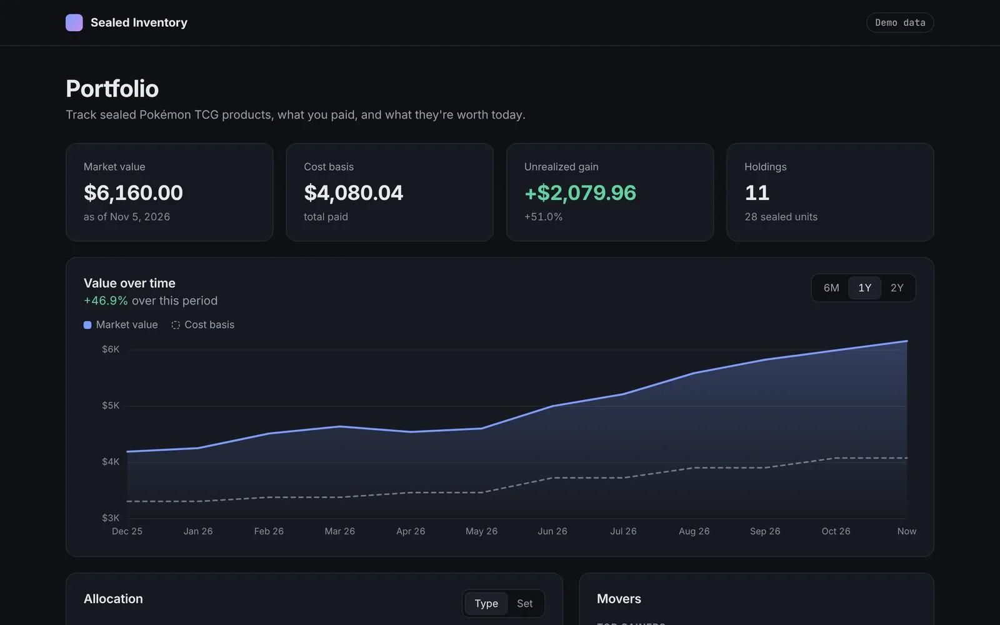
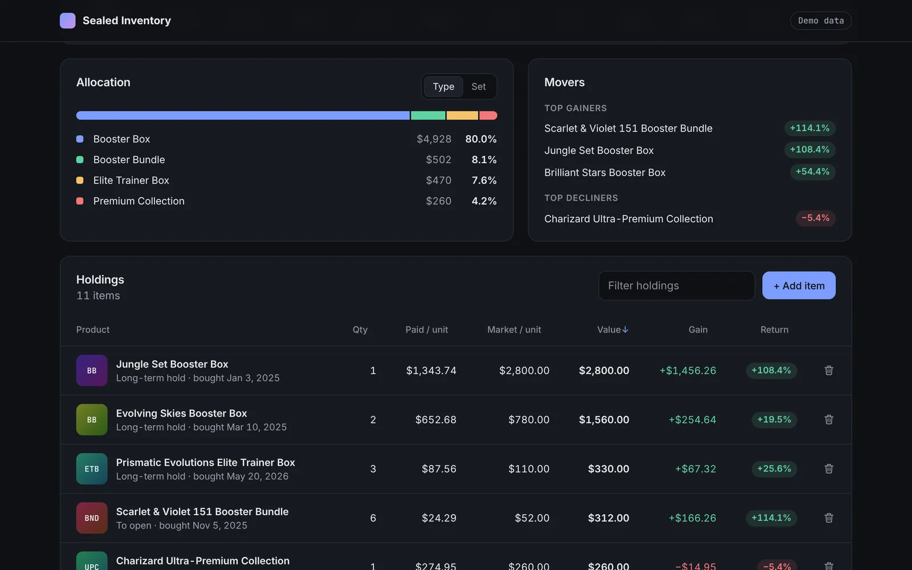

# Sealed Inventory: Pokémon TCG portfolio tracker

A full-stack app for tracking a sealed Pokémon TCG collection: what you paid, what it's worth today, and how its value has changed over time.

**[🔗 Live demo](https://jimmynguyen0313.github.io/pokemon-inventory)** · the API runs on a free tier, so the first load can take about 30 seconds. The demo starts with a sample collection and illustrative prices.



## Highlights

| | |
|---|---|
| **Portfolio analytics** | Market value, cost basis, unrealized gain/loss, return per item, allocation by type and set, top movers |
| **Value over time** | Monthly portfolio value vs. cost basis over 6 months, 1 year or 2 years, from a per-product price history |
| **Fast at scale** | Analytics endpoints answer in **~20 ms** with 10,000 holdings: **4× faster** history and **2.7× faster** holdings list after optimization ([benchmark](#performance)) |
| **Tested** | **35 backend tests at 99% coverage** and **11 frontend tests at 90% line coverage**, run in CI on every push |
| **Lighthouse** | **100** for Performance, Accessibility, Best Practices and SEO, on desktop and mobile |



## Features

- **Dashboard**: summary cards, an interactive value chart with hover details, allocation by product type or set, and top gainers and decliners.
- **Holdings table**: sort by any column, filter as you type, with gain and return per item. On phones it becomes stacked cards.
- **Add items**: a dialog that searches the catalog and prefills the market price. Set quantity, price paid, purchase date and category.
- **Price sync**: pulls products and prices from the [Pokémon Price Tracker API](https://www.pokemonpricetracker.com/api). Each sync adds to the price history.
- **Demo mode**: a fresh database gets 15 products, 24 months of price history and an 11-item sample collection, so the live demo is never empty.

## Tech stack

- **Frontend:** React 19, hand-built SVG charts (no chart library), CSS
- **Backend:** FastAPI, SQLite, Pydantic
- **Testing:** pytest + pytest-cov, Jest + React Testing Library
- **CI/CD:** GitHub Actions; frontend on GitHub Pages, API on Render

## Performance

`python -m backend.benchmark` builds a throwaway database with 10,000 holdings and 24 months of price history, then times each endpoint in-process (50 runs each).

| Endpoint | Before p50 | After p50 | Speedup |
|---|---|---|---|
| `GET /analytics/history?months=24` | 74 ms | 19 ms | **~4×** |
| `GET /items` | 308 ms | 112 ms | **2.7×** |
| `GET /analytics/summary` | 43 ms | 19–26 ms | **~2×** |

What changed:
- **Aggregation moved into SQLite.** Totals, allocation and top movers use `SUM`, `GROUP BY` and `ORDER BY … LIMIT` instead of looping over rows in Python.
- **History groups holdings first.** Holdings are grouped by product and purchase month before valuing them at each date, which cuts 10,000 rows to a few hundred groups. Each group's price on a date is found by binary search over its price history.
- **`/items` skips FastAPI's per-field encoder.** Its rows are already JSON-safe, and the encoder dominated response time.

A comparison script confirmed the optimized analytics return the same results as the original implementation. Numbers vary by machine.

## Running locally

From the project root:

```bash
pip install -r backend/requirements.txt
python -m uvicorn backend.app:app --reload --port 8000
```

In a second terminal:

```bash
npm install
npm start
```

Then open http://localhost:3000. On first run the API creates `backend/inventory.db` with the demo collection. Set `DEMO_DATA=0` to start empty.

To sync real products and prices, set `POKEMON_PRICE_TRACKER_API_KEY` and run:

```bash
python -m backend.sync_products --limit 50
```

## Testing

```bash
pip install -r backend/requirements-dev.txt
pytest backend/tests --cov
```

```bash
npm test -- --watchAll=false --coverage
```

```bash
python -m backend.benchmark --items 10000
```

The backend tests run against a temporary database, with the pricing API faked out, so they need neither a network connection nor an API key.

## API

| Method | Path | Description |
|---|---|---|
| `GET` | `/analytics/summary` | Totals, gain/loss, allocation, top movers |
| `GET` | `/analytics/history?months=12` | Portfolio value and cost basis at the start of each month (2–60) |
| `GET` | `/items` | Holdings with cost basis, value, gain and return |
| `POST` | `/items` | Add a holding |
| `DELETE` | `/items/{id}` | Remove a holding |
| `GET` | `/products/search?name=` | Search the cached catalog |
| `GET` | `/products/{id}/history` | Recorded prices for one product |
| `POST` | `/products/sync` | Sync products and prices from the pricing API |
| `GET`/`POST` | `/categories` | List or create categories |

Interactive docs are at `/docs` when the API is running.

## Project structure

```
backend/
  app.py              FastAPI routes
  analytics.py        Portfolio summary and value-over-time
  db_init.py          Schema: products, items, categories, price_history
  demo_data.py        Sample collection and price history for the demo
  pokemon_api.py      Pricing API client
  benchmark.py        Latency benchmark
  tests/              pytest suite
src/
  App.js              Page layout and data loading
  api.js, format.js   API client and number formatting
  components/         StatCards, ValueChart, Breakdown, HoldingsTable, AddItemDialog, ProductThumb
.github/workflows/    CI (tests) and GitHub Pages deploy
render.yaml           Render deployment config
```

## Configuration

| Variable | Used by | Default | Purpose |
|---|---|---|---|
| `REACT_APP_API_URL` | Frontend (build time) | `http://localhost:8000` | URL of the API |
| `ALLOWED_ORIGINS` | Backend | `http://localhost:3000` | Comma-separated origins allowed by CORS |
| `DATABASE_PATH` | Backend | `backend/inventory.db` | SQLite file location |
| `DEMO_DATA` | Backend | `1` | Seed the sample collection into a new database |
| `POKEMON_PRICE_TRACKER_API_KEY` | Backend | none | Only needed to sync real prices |

## Deployment

### Backend (Render)
1. In Render, choose **New → Blueprint** and select this repo; it reads [`render.yaml`](render.yaml). Or create a web service with start command `uvicorn backend.app:app --host 0.0.0.0 --port $PORT`.
2. Set `ALLOWED_ORIGINS` to the frontend URL.

Render's free disk is ephemeral, so the demo collection is recreated on each deploy or restart.

### Frontend (GitHub Pages)
1. In **Settings → Pages**, set **Source** to **GitHub Actions**.
2. In **Settings → Secrets and variables → Actions → Variables**, add `REACT_APP_API_URL` with the API URL.
3. Push to `main`. [`deploy-pages.yml`](.github/workflows/deploy-pages.yml) tests, builds and publishes the site.

## License

[MIT](LICENSE)

---

Pokémon is a trademark of The Pokémon Company International. This project is not affiliated with or endorsed by it. Demo prices are illustrative, not market data.
